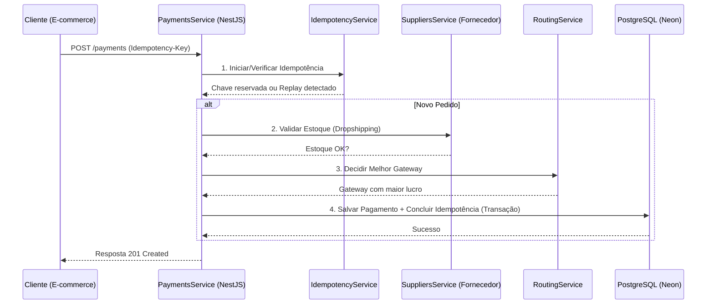

# Payment Router & Dropshipping Validator

Uma API de alto desempenho construída com **NestJS** e **TypeORM**, projetada para resolver problemas reais de e-commerce no modelo de **Dropshipping Nacional**.

[](https://github.com/arthhuur/sistema-e-commerce/actions/workflows/main.yml)

## 🎯 O Problema
No Dropshipping, o estoque não está com o lojista, mas sim com o fornecedor. Processar um pagamento sem antes garantir que o fornecedor tem o produto gera custos de estorno, taxas de gateway e insatisfação do cliente.

## 💡 A Solução
Este projeto implementa um **Roteador de Pagamentos Inteligente** que:
1.  **Valida o Estoque em Tempo Real**: Antes de qualquer cobrança, consulta o fornecedor (simulado pelo `SuppliersService`).
2.  **Roteamento por Custo (Líquido Esperado)**: Escolhe automaticamente o gateway que deixará mais dinheiro no bolso do lojista, considerando taxas fixas, variáveis e taxas de aprovação histórica.
3.  **Idempotência Garantida**: Protege contra cobranças duplicadas usando chaves de idempotência em transações atômicas no banco de dados.
4.  **Acesso Protegido por Perfil**: Autenticação própria (JWT em cookie `httpOnly`, com refresh rotativo), **segundo fator (2FA/TOTP)** opcional por conta e perfis de acesso (gerente, vendedor, estoque). O sistema é **fechado por padrão**: toda rota nova exige sessão, e abrir exceção é explícito.
5.  **Segundo Fator em Duas Etapas**: quando ativo, a senha sozinha não abre sessão — ela libera apenas um token temporário de 5 minutos, e a entrada só se completa com o código de 6 dígitos do aplicativo autenticador (ou um código de recuperação de uso único). O segredo do TOTP fica **cifrado** no banco (AES-256-GCM), nunca em texto puro.
6.  **Pronto para Produção 24/7**: Configurado para rodar no **Neon** (Postgres Serverless) e **Render** (Cloud Hosting), com observabilidade em produção.

## Arquitetura do Sistema

Abaixo está o fluxo de uma transação desde a requisição do cliente até a persistência no banco de dados:



Arquivos de arquitetura:
- [Diagrama editável no Draw.io](./architecture.drawio)
- Fluxo resumido em Mermaid neste próprio README

Para recrutadores e avaliadores, o ideal é abrir primeiro este README e depois o arquivo `architecture.drawio` para ver a visão de componentes.

---

## Tecnologias
-   **Framework**: [NestJS](https://nestjs.com/) (Node.js)
-   **Banco de Dados**: PostgreSQL (Neon.tech)
-   **ORM**: TypeORM com Migrations versionadas.
-   **Autenticação**: JWT em cookie `httpOnly` (refresh rotativo), `argon2` para hash de senha e **2FA/TOTP** (`otplib`) com códigos de recuperação.
-   **Testes**: Vitest (Unitários, E2E e Testes de Volume de 100k registros).
-   **Observabilidade**: [NestJS Observe](https://observe.nestjs.com) (traces, erros, logs e métricas em produção).
-   **CI/CD**: GitHub Actions (lint, testes unitários, E2E e build a cada push).
-   **Infraestrutura**: Docker & Docker Compose.

## Valor de Negócio

Este projeto foi pensado para resolver um problema real de operação em e-commerce:

- evitar cobrar um cliente por um produto sem estoque no fornecedor
- escolher automaticamente o gateway com melhor retorno financeiro
- impedir cobranças duplicadas em retentativas de rede
- manter rastreabilidade, testes e observabilidade para produção

Em termos simples: o sistema decide **quando cobrar**, **por onde cobrar** e **como evitar erro operacional**.

---

## Estrutura do Projeto (Monorepo)

O repositório é um **monorepo com npm workspaces**. A raiz não tem código de aplicação — ela só orquestra os apps:

```txt
payment-router/
├── apps/
│   ├── backend/        # API NestJS (código da aplicação)
│   └── web/            # Interface Next.js (App Router + Tailwind)
├── packages/
│   └── shared/         # Tipos e contratos usados pelos dois lados
├── docs/               # roadmap e documentação
├── package.json        # workspaces + scripts que delegam para os apps
└── Dockerfile          # build a partir da raiz
```

Os scripts da raiz **delegam** para o app correspondente, então os comandos desta seção continuam sendo executados a partir da raiz:

```bash
npm run start:dev     # roda o NestJS dentro de apps/backend
npm run test          # testes unitários
npm run test:e2e      # testes de integração
npm run build         # compila a API
npm run dev:web       # roda o Next.js em apps/web (http://localhost:3001)
npm run build:web     # compila a interface
```

A vantagem prática: o deploy da API continua apontando para a raiz, e a interface entra em `apps/web` sem mexer no que já funcionava.

### Como a interface conversa com a API

O navegador **só fala com o front**. O Next.js reescreve tudo o que chega em `/api/...` para a URL da API (definida em `BACKEND_URL`), tirando o prefixo no caminho:

```txt
navegador -> http://localhost:3001/api/auth/login
                        |
                        +-- Next reescreve --> http://localhost:3000/auth/login
```

Isso não é detalhe de organização: como tudo sai do **mesmo domínio**, o cookie de sessão `httpOnly` passa a ser "de primeira parte" e o navegador o envia sem bloqueio. Se o front chamasse a API em outro domínio, o cookie seria de terceiros — bloqueado por padrão no Safari e no Chrome — e o login não funcionaria.

Consequência prática: **não é preciso CORS nem `COOKIE_SAME_SITE=none`** quando a interface publica a API sob o próprio domínio.

```bash
cp apps/web/.env.example apps/web/.env.local
```


---

## Como Rodar o Projeto

### 1. Requisitos
-   Node.js 22+
-   Docker (opcional)
-   PostgreSQL local ou conta no Neon.tech

### 2. Configuração
Crie o arquivo `apps/backend/.env` (copiando o `apps/backend/.env.example`):
```env
# Banco de dados (a URL pronta que o Neon entrega no painel)
POSTGRES_URL=sua_url_do_neon_aqui
POSTGRES_SSL=true
PORT=3000
NODE_ENV=development

# Segredo que assina os tokens de sessão. OBRIGATÓRIO fora de
# development/test: a API se recusa a subir sem ele (mínimo 32 caracteres).
# Gere com: node -e "console.log(require('crypto').randomBytes(48).toString('base64url'))"
JWT_SECRET=troque-por-um-segredo-de-32-caracteres-ou-mais

# Origens do front autorizadas, separadas por vírgula. Obrigatório em produção.
CORS_ORIGINS=

# Observabilidade (opcional em desenvolvimento): npx @nestjs/observe link
OBSERVE_APP_KEY=
OBSERVE_APP_SECRET=
```

> **Nota:** o `apps/backend/.env.example` é a referência completa e comentada de todas as variáveis.

### 3. Execução Local
```bash
# Instalar dependências
npm install

# Rodar migrações (cria as tabelas no banco)
npm run migration:run

# Criar o primeiro usuário (gerente). Rode uma vez, na primeira subida.
# A senha precisa ter 12+ caracteres. Rodar de novo com o mesmo e-mail
# redefine a senha sem duplicar a conta.
npm run seed:user -- --email=gerente@loja.com --password=uma-senha-longa

# Iniciar em modo desenvolvimento
npm run start:dev
```

### 4. Execução com Docker
```bash
docker build -t payment-router .
docker run -p 3000:3000 --env-file apps/backend/.env payment-router
```

---

## Testes de Qualidade
O projeto foi construído seguindo rigorosos padrões de testes:
-   **Fluxo de Pagamento**: Garante que a lógica de "validar -> rotear -> cobrar" funciona do início ao fim.
-   **Idempotência**: Prova que retentativas de rede não geram cobranças duplicadas.
-   **Volume**: Teste de estresse que valida a performance linear processando **100.000 transações** em milissegundos.

```bash
# Rodar todos os testes
npm test

# Rodar testes E2E (Integração)
npm run test:e2e
```

---

## Arquitetura e Decisões Técnicas
-   **Segurança (PCI-DSS)**: A API nunca toca em dados sensíveis de cartão. Ela recebe apenas o resultado da operação e IDs de referência.
-   **Padrão Fechado**: os guards de sessão e de perfil são globais (`APP_GUARD`). Toda rota nova nasce protegida; abrir exceção exige marcar com `@Public()`.
-   **Sessão em Cookie `httpOnly`**: o token nunca é exposto ao JavaScript da página (imune a XSS), com refresh rotativo de 7 dias no banco.
-   **Segundo Fator (TOTP)**: o login passa a ter duas etapas — a senha emite um token temporário de 5 minutos (cookie `httpOnly`, `scope: 'mfa'`) e a sessão só abre com o código do autenticador. O segredo do TOTP é cifrado com AES-256-GCM (chave por HKDF), e os códigos de recuperação são guardados como SHA-256 e consumidos por `UPDATE` condicional (uso único, sem corrida).
-   **Atomicidade**: O uso de `manager.transaction` garante que ou o pagamento é gravado E a chave de idempotência é marcada como concluída, ou nada acontece.
-   **Escalabilidade**: O uso de `synchronize: false` e Migrations permite que o esquema do banco evolua com segurança sem risco de perda de dados em produção.

## Demonstração Técnica

Com a API rodando localmente, a documentação interativa fica disponível em:

```txt
http://localhost:3000/api
```

Para inspeção direta do contrato OpenAPI:

```txt
http://localhost:3000/api-json
```

> A maioria das rotas exige sessão. Faça o login em `POST /auth/login` antes de testar as demais — o navegador passa a enviar o cookie de sessão automaticamente.

## Próxima Evolução do Projeto

O próximo passo deste projeto será criar uma **interface para o usuário**, para que a solução deixe de ser apenas uma API técnica e passe a funcionar como um sistema utilizável no dia a dia — inclusive por quem não é da área técnica.

Princípios da interface:

- **simples antes de completo**: pouca informação por tela, uma decisão por tela
- **detalhe sob demanda**: o resumo fica visível, o detalhe fica a um clique
- **acesso por perfil**: gerente, vendedor e estoque veem coisas diferentes
- **abre em qualquer dispositivo**: sem depender de máquina ligada

Decisões e o que já está pronto para a próxima fase:

| Decisão | Escolha | Situação |
| --- | --- | --- |
| Autenticação | Própria, dentro do NestJS (usuários, JWT em cookie e guards por perfil) | ✅ implementada |
| Tecnologia do front | Next.js (App Router + Tailwind), publicado na Vercel | ✅ em andamento |
| Organização do código | Monorepo (`apps/backend`, `apps/web`, `packages/shared`) | ✅ montado |
| Primeira entrega | Login (com 2FA) + Dashboard | ✅ concluída |
| Segunda entrega | Tela de Pagamentos (lista, filtro de período e detalhe) | ✅ concluída |
| Terceira entrega | Gateways: leitura, simulação, cadastro, edição e exclusão | ✅ concluída |

A interface já existe em `apps/web`. O **login funciona de ponta a ponta** (e-mail e senha, segunda etapa do 2FA, sessão em cookie `httpOnly` e logout) e o **dashboard mostra a operação do dia**: quatro números (total processado, vendas aprovadas, ticket médio e líquido recebido, com as taxas como legenda) e os cinco últimos pagamentos.

A **tela de pagamentos** (`/pagamentos`) é o nível de detalhe abaixo do resumo: lista paginada de `GET /payments`, filtro por período (`from`/`to`) e o registro completo de cada linha aberto no clique — sem tela nova e sem endpoint novo. O estado da lista mora na URL (página e datas), então o endereço é compartilhável e o botão "voltar" do navegador funciona como se espera. O filtro é só de período de propósito: hoje o único status existente é `approved`, e um filtro com uma opção só seria enfeite.

A **tela de gateways** (`/gateways`) agora fecha a Fase 3 inteira: lista, simula, cadastra, edita e exclui. A lista mostra taxa percentual, taxa fixa e aprovação observada, e abre um simulador por linha que chama `GET /gateways/:id/estimate` para responder quanto sobra em uma venda de R$ X. Para o gerente, a mesma área também abre `Novo gateway`, `Editar gateway` em página própria e `Excluir gateway` com confirmação inline na própria tela. O cálculo continua no servidor; a tela só formata. O mesmo cabeçalho do painel agora dá acesso a `Pagamentos` e `Gateways`, e a guarda do Next protege `/gateways`, `/gateways/novo` e `/gateways/:id/editar`.

A proteção de rotas acontece em duas camadas — a guarda do Next (`proxy.ts`) faz a checagem otimista para dar o desvio certo, e cada rota da API confere a sessão de verdade. Os números do dashboard vêm prontos de `GET /dashboard/summary` (restrito aos perfis gerente e financeiro): a tela não soma nada, só exibe.

O próximo passo são as telas da **Fase 4** (produtos, disponibilidade e vínculo com fornecedor).


Plano completo da próxima fase: [Frontend Roadmap](./docs/frontend-roadmap.md)

---

## Licença
Este projeto é para fins de portfólio e estudo de arquitetura de sistemas financeiros.
