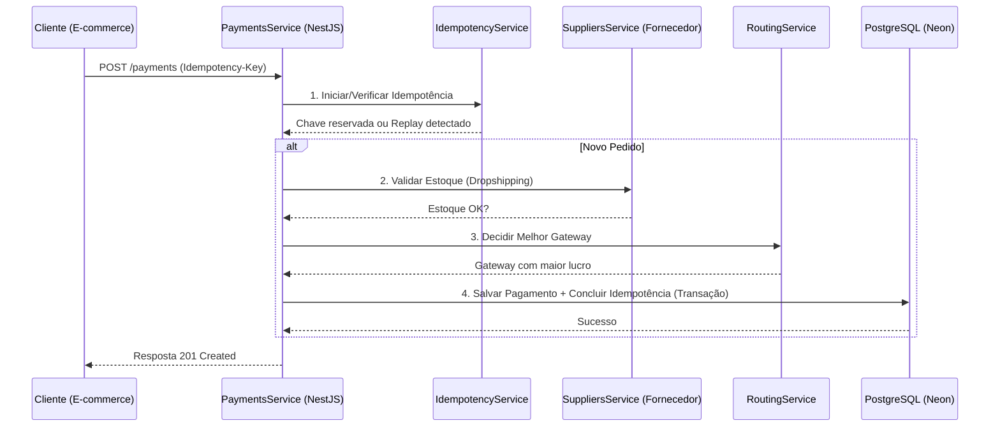

# Payment Router & Dropshipping Validator

Uma API de alto desempenho construída com **NestJS** e **TypeORM**, projetada para resolver problemas reais de e-commerce no modelo de **Dropshipping Nacional**.

## 🎯 O Problema
No Dropshipping, o estoque não está com o lojista, mas sim com o fornecedor. Processar um pagamento sem antes garantir que o fornecedor tem o produto gera custos de estorno, taxas de gateway e insatisfação do cliente.

## 💡 A Solução
Este projeto implementa um **Roteador de Pagamentos Inteligente** que:
1.  **Valida o Estoque em Tempo Real**: Antes de qualquer cobrança, consulta o fornecedor (simulado pelo `SuppliersService`).
2.  **Roteamento por Custo (Líquido Esperado)**: Escolhe automaticamente o gateway que deixará mais dinheiro no bolso do lojista, considerando taxas fixas, variáveis e taxas de aprovação histórica.
3.  **Idempotência Garantida**: Protege contra cobranças duplicadas usando chaves de idempotência em transações atômicas no banco de dados.
4.  **Pronto para Produção 24/7**: Configurado para rodar no **Neon** (Postgres Serverless) e **Render** (Cloud Hosting).

## Arquitetura do Sistema

Abaixo está o fluxo de uma transação desde a requisição do cliente até a persistência no banco de dados:



Arquivos de arquitetura:
- [Diagrama editável no Draw.io](./architecture.drawio)
- Fluxo resumido em Mermaid neste próprio README

Para recrutadores e avaliadores, o ideal é abrir primeiro este README e depois o arquivo `architecture.drawio` para ver a visão de componentes.

---

## Tecnologias
-   **Framework**: [NestJS](https://nestjs.com/) (Node.js)
-   **Banco de Dados**: PostgreSQL (Neon.tech)
-   **ORM**: TypeORM com Migrations versionadas.
-   **Testes**: Vitest (Unitários, E2E e Testes de Volume de 100k registros).
-   **Infraestrutura**: Docker & Docker Compose.

## Valor de Negócio

Este projeto foi pensado para resolver um problema real de operação em e-commerce:

- evitar cobrar um cliente por um produto sem estoque no fornecedor
- escolher automaticamente o gateway com melhor retorno financeiro
- impedir cobranças duplicadas em retentativas de rede
- manter rastreabilidade, testes e observabilidade para produção

Em termos simples: o sistema decide **quando cobrar**, **por onde cobrar** e **como evitar erro operacional**.

---

## Como Rodar o Projeto

### 1. Requisitos
-   Node.js 22+
-   Docker (opcional)
-   PostgreSQL local ou conta no Neon.tech

### 2. Configuração
Crie um arquivo `.env` na raiz (baseado no `.env.example`):
```env
POSTGRES_URL=sua_url_do_neon_aqui
POSTGRES_SSL=true
PORT=3000
```

### 3. Execução Local
```bash
# Instalar dependências
npm install
npm install

# Rodar migrações (cria as tabelas no banco)
npm run migration:run

# Iniciar em modo desenvolvimento
npm.cmd run start:dev
```

### 4. Execução com Docker
```bash
docker build -t payment-router .
docker run -p 3000:3000 --env-file .env payment-router
```

---

## Testes de Qualidade
O projeto foi construído seguindo rigorosos padrões de testes:
-   **Fluxo de Pagamento**: Garante que a lógica de "validar -> rotear -> cobrar" funciona do início ao fim.
-   **Idempotência**: Prova que retentativas de rede não geram cobranças duplicadas.
-   **Volume**: Teste de estresse que valida a performance linear processando **100.000 transações** em milissegundos.

```bash
# Rodar todos os testes
npm test

# Rodar testes E2E (Integração)
npm run test:e2e
```

---

## Arquitetura e Decisões Técnicas
-   **Segurança (PCI-DSS)**: A API nunca toca em dados sensíveis de cartão. Ela recebe apenas o resultado da operação e IDs de referência.
-   **Atomicidade**: O uso de `manager.transaction` garante que ou o pagamento é gravado E a chave de idempotência é marcada como concluída, ou nada acontece.
-   **Escalabilidade**: O uso de `synchronize: false` e Migrations permite que o esquema do banco evolua com segurança sem risco de perda de dados em produção.

## Demonstração Técnica

Com a API rodando localmente, a documentação interativa fica disponível em:

```txt
http://localhost:3000/api
```

Para inspeção direta do contrato OpenAPI:

```txt
http://localhost:3000/api-json
```

## Próxima Evolução do Projeto

O próximo passo deste projeto será criar uma **interface para o usuário**, para que a solução deixe de ser apenas uma API técnica e passe a funcionar como um sistema utilizável no dia a dia.

Objetivos da próxima fase:

- criar um painel web para operação do sistema
- permitir que usuários não técnicos visualizem pedidos, pagamentos e conciliações
- apresentar status de estoque, gateway escolhido e resultado da cobrança de forma clara
- transformar a base atual em uma evolução natural para um produto pronto para uso

Planejamento inicial da próxima etapa:

- `apps/backend`: API NestJS já existente
- `apps/web`: painel administrativo e operacional
- `packages/shared`: contratos, tipos e utilitários compartilhados

Neste momento, o repositório permanece **unificado** para facilitar leitura, setup e avaliação técnica. Depois que a interface for desenvolvida, essa evolução ficará registrada como a próxima grande versão do projeto.

Plano da próxima fase: [Frontend Roadmap](./docs/frontend-roadmap.md)

---

## Licença
Este projeto é para fins de portfólio e estudo de arquitetura de sistemas financeiros.
